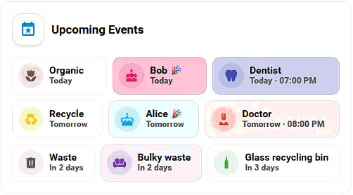
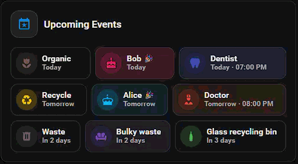

[](https://hacs.xyz/)
[](https://github.com/KroFR/event-spotlight-ha-card/releases)
[](https://www.home-assistant.io/)
[](https://github.com/KroFR/event-spotlight-ha-card/actions/workflows/hacs.yaml)
[](https://github.com/KroFR/event-spotlight-ha-card/blob/main/LICENSE)

# 📅 Event Spotlight Card

A custom Lovelace card for [Home Assistant](https://www.home-assistant.io/) that highlights the calendar events that matter to you.

Instead of displaying every event from your calendars, Event Spotlight Card uses rules to select specific events and present them with custom labels, icons, colors, and layouts. Use it for waste collections, birthdays, anniversaries, medical appointments, reminders, or any other events you want to keep in sight.

| Light Theme | Dark Theme |
|---|---|
|  |  |

## ✨ Features

- Select events with ordered Include rules and priority Exclude rules
- Match title, description, location, or calendar source with text operators or regular expressions
- Customize matching events with labels, icons, colors, backgrounds, Blink, and Pulse effects
- Show only the next event for recurring matches
- Six layouts: `Bubble`, `Chips`, `Mushroom`, `Pro`, `Square`, and `Ticker`
- Eight card arrangements for Chips and Mushroom: `Left`, `Center`, `Right`, `Justified`, `Stretched`, `List`, `2 columns`, and `3 columns`
- Optional relative date, time, description, location, and calendar source
- Automatic refresh, live Light/Dark theme updates, English/French localization, and a visual editor
- No YAML knowledge required

> [!IMPORTANT]
> Event Spotlight Card is rule-driven. An event must match an **Include** rule to be displayed.

## ℹ️ Prerequisites

- Home Assistant 2024.6 or newer
- At least one `calendar.*` entity

The card retrieves upcoming calendar data using Home Assistant's `calendar.get_events` action.

## 📦 Installation

### HACS (recommended)

1. Open HACS in Home Assistant.
2. Open the three-dot menu and select **Custom repositories**.
3. Add: `https://github.com/KroFR/event-spotlight-ha-card`
4. Select **Dashboard** as the category.
5. Click **Add**.
6. Search for **Event Spotlight Card** and install it.
7. Refresh Home Assistant if required.

### Manual

1. Download `event-spotlight-card.js` from the `dist` folder of this repository.
2. Copy it to `/config/www/event-spotlight-card.js`.
3. Go to **Settings > Dashboards > Resources**.
4. Add `/local/event-spotlight-card.js` as a **JavaScript module**.
5. Refresh the browser.

## 🚀 Getting started

1. Edit a dashboard and select **Add Card**.
2. Search for **Event Spotlight Card**.
3. Add one or more calendars.
4. Open **Event rules** and create at least one Include rule.
5. Choose a layout and customize the appearance.

A minimal useful configuration looks like this:

```yaml
type: custom:event-spotlight-card
calendars:
  - entity: calendar.family
rules:
  - action: include
    field: summary
    operator: contains
    value: Birthday
    icon: mdi:cake-variant
    color: pink
```

Without a matching Include rule, the card displays `No matching events`.

## ⚙️ Configuration

### Calendars

Add one or more Home Assistant calendar entities:

```yaml
calendars:
  - entity: calendar.family
  - entity: calendar.personal
  - entity: calendar.waste_collection
```

The calendars are only event sources. Event rules decide which events are displayed.

### General options

| Name | Type | Required | Default | Description |
|---|---|---:|---|---|
| `type` | string | yes | — | `custom:event-spotlight-card` |
| `calendars` | list | yes | — | One or more `calendar.*` entities |
| `name` | string | no | `Upcoming Events` | Card header title |
| `days` | number | no | `30` | Number of days to search ahead |
| `update_interval` | number | no | `60` | Calendar refresh interval in minutes, from 1 to 1440 |
| `all_day_hide_time` | time | no | `23:59` | Time at which today's all-day events disappear |
| `language` | string | no | `auto` | `auto`, `en`, or `fr` |
| `layout` | string | no | `mushroom` | `bubble`, `chips`, `mushroom`, `pro`, `square`, or `ticker` |
| `card_arrangement` | string | no | `left` | Arrangement for Chips and Mushroom: `left`, `center`, `right`, `justified`, `stretched`, `list`, `2-columns`, or `3-columns` |
| `show_title` | boolean | no | `true` | Show the card header |
| `show_title_icon` | boolean | no | `true` | Show the icon in the card header |
| `show_card_background` | boolean | no | `true` | Show the outer Home Assistant card background |
| `ticker_mushroom_shape` | boolean | no | `false` | Ticker only. Replace the pill shape with the standard Mushroom card radius |
| `ticker_invert_light_colors` | boolean | no | `false` | Ticker only. In Light theme, use the default Home Assistant card background and the light grey secondary background for the date circle |
| `show_relative_date` | boolean | no | `true` | Show relative dates such as `Today` and `In 3 days` |
| `show_time` | boolean | no | `true` | Show event time when available |
| `show_description` | boolean | no | `false` | Show event description when available |
| `show_location` | boolean | no | `false` | Show event location when available |
| `show_calendar_source` | boolean | no | `false` | Show the source calendar name |
| `display_order` | list | no | `date_time`, `description`, `location`, `calendar` | Order of event details |

## 🎨 Layouts

### Mushroom

The default layout. Events are displayed as compact Mushroom-style cards with an icon, title, and selected details.

| Light Theme | Dark Theme |
|---|---|
|  |  |

### Chips

Displays matching events as compact pill-shaped chips. Useful when dashboard space is limited.

| Light Theme | Dark Theme |
|---|---|
|  |  |

### Bubble

Groups events by day and displays each event as a compact timeline entry. Event time and relative date stay on the first line. Description, location, and calendar source follow the configured display order.

| Light Theme | Dark Theme |
|---|---|
|  |  |

### Pro

Groups events by day in a full-width timeline-style layout. The day is displayed once, and event details use dedicated icons for time, description, location, and calendar source.

| Light Theme | Dark Theme |
|---|---|
|  |  |

### Square

Displays matching events as responsive square-style tiles.

| Light Theme | Dark Theme |
|---|---|
|  |  |

### Ticker

Displays two upcoming events in a compact horizontal card. A date circle shows the date of the first visible event. When more than two events are available, the list scrolls vertically every three seconds and the date circle follows the first visible event.

Ticker-specific options:

- `ticker_mushroom_shape`: use the standard Mushroom card radius instead of the default pill shape.
- `ticker_invert_light_colors`: in Light theme, use the default Home Assistant card background and the secondary light grey background for the date circle.

| Light Theme | Dark Theme |
|---|---|
|   |   |

## 🎯 Event rules

Rules decide which events are displayed and how they look.

### Evaluation order

1. Every Exclude rule is evaluated first. A match hides the event.
2. Include rules are evaluated from top to bottom.
3. The first matching Include rule wins. Later Include rules are not evaluated.
4. If no Include rule matches, the event is hidden.

Reorder Include rules in the visual editor to set their priority. Place specific rules above broad rules.

```yaml
rules:
- action: exclude                        # Any event with the word `doctor` in its title will be hidden.
    field: summary
    operator: contains
    value: doctor

- action: include                        # Any event with the word `dentist` in its title will be displayed using the rule settings.
    field: summary
    operator: equals
    value: Dentist
    icon: mdi:tooth
    color: indigo

- action: include                        # Only events containing `specialist` reach this rule, as previous rules take priority.
    field: summary
    operator: regex
    value: '\b(doctor|dentist|specialist)\b'
    icon: mdi:doctor
    color: red
```

### Rule options

| Name | Values | Description |
|---|---|---|
| `rule_name` | Text | Optional name used only to identify the rule in the visual editor |
| `action` | `include`, `exclude` | Defines whether a matching event is displayed or excluded |
| `field` | `summary`, `description`, `location`, `calendar` | Event field used for matching |
| `operator` | `contains`, `equals`, `starts_with`, `ends_with`, `regex` | Matching method applied to the selected field |
| `value` | Text or regex | Value or pattern to match |
| `label` | Text | Optional label that replaces the event summary when displayed |
| `icon` | `mdi:*`, `hacs:*`, `advanced-camera-card:*` | Optional icon applied to matching events |
| `color` | HA theme color or CSS color | Color used to highlight matching events |
| `show_icon_background_color` | `true`, `false` | Apply the selected color to the icon background |
| `show_background_color` | `true`, `false` | Apply the selected color to the event background |
| `show_first_match_only` | `true`, `false` | Display only the next upcoming event matching this rule |
| `blink_background` | `true`, `false` | Blink the event background when the configured highlight period starts |
| `blink_start_minutes` | `30` to `360`, 30-minute steps | Number of minutes before a timed event when Blink starts |
| `pulse_background` | `true`, `false` | Pulse the event when the configured highlight period starts |
| `pulse_start_minutes` | `30` to `360`, 30-minute steps | Number of minutes before a timed event when Pulse starts |

Blink and Pulse can be used independently or together. For all-day events, enabled effects start on the event day and remain active until the event is hidden at the time defined by `all_day_hide_time`.

### Matching operators

| Operator| Description |
| ------- | ----------- |
| `contains` | The field contains the specified value anywhere in its text |
| `equals` | The entire field exactly matches the specified value |
| `starts_with` | The field starts with the specified value |
| `ends_with` | The field ends with the specified value |
| `regex` | The field matches a case-insensitive, Unicode-aware JavaScript regular expression. Invalid expressions simply do not match |

Regex examples:

| Pattern | Example matches |
|---|---|
| `birthday\|anniversary` | Birthday or anniversary anywhere in the selected field |
| `^birthday` | Values starting with `birthday` |
| `birthday$` | Values ending with `birthday` |
| `\b(doctor\|dentist)\b` | Matches doctor or dentist as complete words |
| `recycl(e\|ing\|ables)` | Different recycling terms |

## ⏱️ Event visibility

- Timed events disappear as soon as their start time is reached.
- All-day events remain visible until `all_day_hide_time`, which defaults to `23:59`.
- The card schedules these removals automatically. It does not wait for the next `update_interval` refresh.

## 🎨 Colors

The card supports Home Assistant theme colors:

`primary`, `accent`, `red`, `pink`, `purple`, `deep-purple`, `indigo`, `blue`, `light-blue`, `cyan`, `teal`, `green`, `light-green`, `lime`, `yellow`, `amber`, `orange`, `deep-orange`, `brown`, `light-grey`, `grey`, `dark-grey`, and `blue-grey`.

Custom CSS colors are also supported, including hexadecimal values:

```yaml
color: "#ff0000"
```

With transparency:

```yaml
color: "#ff000080"
```

## ↔️ Card arrangements

Card arrangements are available for the `Chips` and `Mushroom` layouts. Other layouts use their own fixed presentation.

| Arrangement | Behavior |
|---|---|
| `left` | Keep natural card widths and align cards to the left |
| `center` | Keep natural card widths and center cards |
| `right` | Keep natural card widths and align cards to the right |
| `justified` | Keep natural card widths and distribute free space between cards |
| `stretched` | Use natural card widths to determine wrapping, then let cards on each row share the full available width |
| `list` | Display one full-width card per row |
| `2-columns` | Display cards in two equal-width columns and truncate overflowing text |
| `3-columns` | Display cards in three equal-width columns and truncate overflowing text |

## 🔒 Runtime safeguards

The card applies defensive limits to keep the dashboard responsive and reduce unsafe input handling:

- Calendar search range is clamped from 1 to 365 days.
- Up to 500 matching events are rendered.
- Regular expression patterns are limited to 256 characters and tested against at most 4,096 characters per field.
- Rule actions, fields, operators, icon prefixes, and custom colors are validated before rendering.

## 📝 Usage examples

### Waste collections

```yaml
type: custom:event-spotlight-card
name: Waste collection
calendars:
  - entity: calendar.waste_collection
layout: mushroom
card_arrangement: stretched
rules:
  - action: include
    field: summary
    operator: contains
    value: Recyclables
    label: Recyclables
    icon: mdi:recycle
    color: yellow

  - action: include
    field: summary
    operator: contains
    value: Waste
    label: Household waste
    icon: mdi:trash-can
    color: dark-grey
```

### Birthdays and anniversaries

```yaml
type: custom:event-spotlight-card
calendars:
  - entity: calendar.family
rules:
  - action: include
    field: summary
    operator: regex
    value: 'birthday|anniversary'
    icon: mdi:cake-variant
    color: pink
```

### Medical appointments

```yaml
type: custom:event-spotlight-card
calendars:
  - entity: calendar.personal
rules:
  - action: include
    field: summary
    operator: regex
    value: '\b(doctor|dentist)\b'
    label: Medical appointment
    icon: mdi:doctor
    color: red
    pulse_background: true
    pulse_start_minutes: 120
    blink_background: true
    blink_start_minutes: 30
```

### Include a category but remove cancelled events

```yaml
type: custom:event-spotlight-card
calendars:
  - entity: calendar.personal
rules:
  - action: include
    field: summary
    operator: contains
    value: Appointment
    icon: mdi:calendar-clock
    color: blue

  - action: exclude
    field: summary
    operator: contains
    value: Cancelled
```

### Match a specific source calendar

```yaml
type: custom:event-spotlight-card
calendars:
  - entity: calendar.family
  - entity: calendar.personal
rules:
  - action: include
    field: calendar
    operator: equals
    value: Family
    icon: mdi:account-group
    color: green
```

## 📄 License

[](https://github.com/KroFR/event-spotlight-ha-card/blob/main/LICENSE)

Released under the MIT License.
